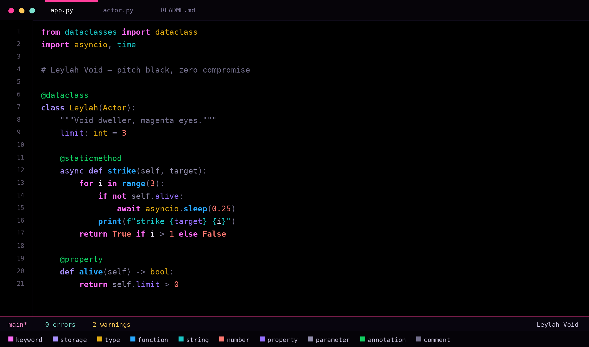

# Leylah Void

**A pitch-black VS Code theme built on one palette, in three contrast tiers.**

Black background, neon magenta trim, violet starfield, gold armor, ice-blue accent — and a syntax palette where every color is mathematically related to the others instead of being picked one at a time.



<p>
  
  
  
</p>

---

## The design system

### 1. One register: neon

The whole syntax palette is **maximum-chroma neon** — each hue is pushed to the edge of the sRGB gamut at its lightness. There is no mixing of matte and gloss, no pastel token sitting next to a neon one, no muted accent beside a saturated one.

The greys are not neutral greys either: they are the violet hue at very low chroma, so even the quiet parts belong to the same family.

### 2. Three contrast tiers

Colors are grouped by how much attention they deserve, not by taste. Within a tier every color is solved to the **same contrast ratio against `#000000`**, so no token accidentally shouts louder than its neighbours.

| Tier | Contrast vs black | What lives here |
| --- | --- | --- |
| **Signal** | **8.0 – 10.0 : 1** | keywords, functions, types, strings, numbers, annotations |
| **Support** | **6.0 – 6.7 : 1** | properties, variables, parameters, doc comments |
| **Noise** | **4.3 – 4.6 : 1** | operators, punctuation, comments |

The result is the hierarchy from the feedback: a line of ordinary code stays calm, and the moment a function name or a keyword appears, it is the brightest thing on screen.

### 3. Colour theory

The hues form an **analogous arc** — magenta → violet → blue → cyan → green — with two warm anchors, **gold** and **coral**, sitting opposite the blue end. Adjacent hues are at least 30° apart, and every pair in the signal tier is separated by an OKLab distance of **ΔE ≥ 0.13** (roughly six times the just-noticeable difference).

### 4. The palette

| Role | Tier | Color | Contrast | Style |
| --- | --- | --- | --- | --- |
| Keywords — `if` `for` `return` `await` | signal | `#FE6BF5` | 8.64:1 | bold |
| Declarations — `const` `def` `class` `async` | signal | `#A890FD` | 8.07:1 | — |
| Functions & methods | signal | `#28A7FD` | 8.04:1 | bold |
| Strings, namespaces, regex | signal | `#1AC6C6` | 9.94:1 | — |
| Types, classes, interfaces, enums | signal | `#E0AA12` | 9.93:1 | — |
| Numbers, booleans, `null` / `None` | signal | `#FD7770` | 8.05:1 | — |
| Annotations — `@Override` `@dataclass` | signal | `#11CD61` | 9.93:1 | italic |
| Properties, fields, attributes | support | `#9570FD` | 6.01:1 | — |
| Variables & identifiers | support | `#918DAB` | 6.60:1 | — |
| Parameters | support | `#918DAB` | 6.60:1 | italic |
| Operators | noise | `#777390` | 4.64:1 | — |
| Punctuation & brackets | noise | `#777390` | 4.64:1 | — |
| Comments | noise | `#726E8B` | 4.32:1 | italic |

UI surfaces stay between `#000000` and `#100A1B`, borders are deep indigo `#171129`, and the magenta `#FE6BF5` marks the cursor, active tab, focus ring and badges.

Semantic highlighting is enabled, so types, functions and properties stay correctly colored even where a grammar is ambiguous.

---

## Install

The theme ships as a standard `.vsix`, so it works in VS Code, VSCodium and any VS Code–compatible editor.

### VS Code

**GUI:** download [`dist/leylah-void-2.0.0.vsix`](dist/leylah-void-2.0.0.vsix), then open the Extensions view (`Ctrl+Shift+X`) → `...` menu → **Install from VSIX…** and pick the file.

**Terminal:**

```bash
code --install-extension dist/leylah-void-2.0.0.vsix
```

### VSCodium

**GUI:** same as above — Extensions view → `...` → **Install from VSIX…**

**Terminal:**

```bash
codium --install-extension dist/leylah-void-2.0.0.vsix
```

> On some distros the binary is called `vscodium` instead of `codium`.

### Cursor, Windsurf and other VS Code forks

Each fork has its own CLI that accepts the same file:

```bash
cursor --install-extension dist/leylah-void-2.0.0.vsix
windsurf --install-extension dist/leylah-void-2.0.0.vsix
```

Or use the GUI: Extensions view → `...` → **Install from VSIX…**

### code-server / browser VS Code

```bash
code-server --install-extension dist/leylah-void-2.0.0.vsix
```

### Manual install (no CLI, no VSIX)

Copy the repository folder into your editor's extensions directory, so that `package.json` sits directly inside it:

| Editor | Linux | macOS | Windows |
| --- | --- | --- | --- |
| VS Code | `~/.vscode/extensions/leylah-void` | `~/.vscode/extensions/leylah-void` | `%USERPROFILE%\.vscode\extensions\leylah-void` |
| VSCodium | `~/.vscode-oss/extensions/leylah-void` | `~/.vscode-oss/extensions/leylah-void` | `%USERPROFILE%\.vscode-oss\extensions\leylah-void` |

Restart the editor afterwards.

### Build it yourself

No Node.js required — the build script only uses the Python standard library:

```bash
git clone https://github.com/Pushkar7270/leylah-void-vs-theme.git
cd leylah-void-vs-theme
python3 scripts/build-vsix.py
# -> dist/leylah-void-2.0.0.vsix
```

Regenerating the preview image and icon needs [Pillow](https://python-pillow.org/):

```bash
python3 scripts/make-assets.py
```

---

## Activate the theme

After installing, the editor may keep your current theme. Select it once:

1. Press `Ctrl+K Ctrl+T` (`Cmd+K Cmd+T` on macOS).
2. Choose **Leylah Void**.

To make it the default, add this to your `settings.json` (`Ctrl+Shift+P` → **Preferences: Open User Settings (JSON)**):

```json
{
  "workbench.colorTheme": "Leylah Void",
  "editor.semanticHighlighting.enabled": true,
  "editor.bracketPairColorization.enabled": true
}
```

The last two lines are optional but recommended — they enable the semantic colors and bracket colors the theme is designed around.

## Uninstall

```bash
code --uninstall-extension pushkar7270.leylah-void      # VS Code
codium --uninstall-extension pushkar7270.leylah-void    # VSCodium
```

Or right-click the extension in the Extensions view → **Uninstall**.

---

## Repository layout

```
.
├── package.json                        # extension manifest
├── themes/
│   └── leylah-void-color-theme.json    # 535 UI colors + token rules
├── assets/
│   ├── preview.png                     # README preview (generated)
│   └── icon.png                        # extension icon (generated)
├── scripts/
│   ├── build-vsix.py                   # builds dist/*.vsix, stdlib only
│   ├── install-local.sh                # build + install + drop stale copies
│   └── make-assets.py                  # regenerates preview + icon (Pillow)
├── dist/
│   └── leylah-void-2.0.0.vsix          # ready-to-install package
├── CHANGELOG.md
└── LICENSE
```

## Notes

- The palette was sampled from a reference illustration; neither the artwork nor any character asset is redistributed here.
- The theme targets `vs-dark`; there is no light variant.
- Tested on VSCodium 1.140 and VS Code 1.60+.

## License

[MIT](LICENSE)
