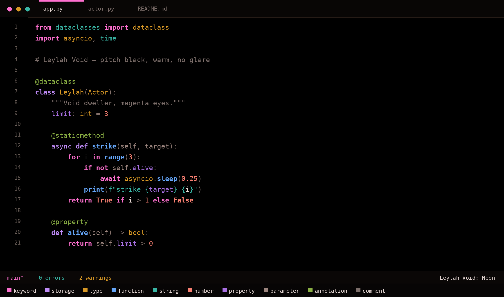
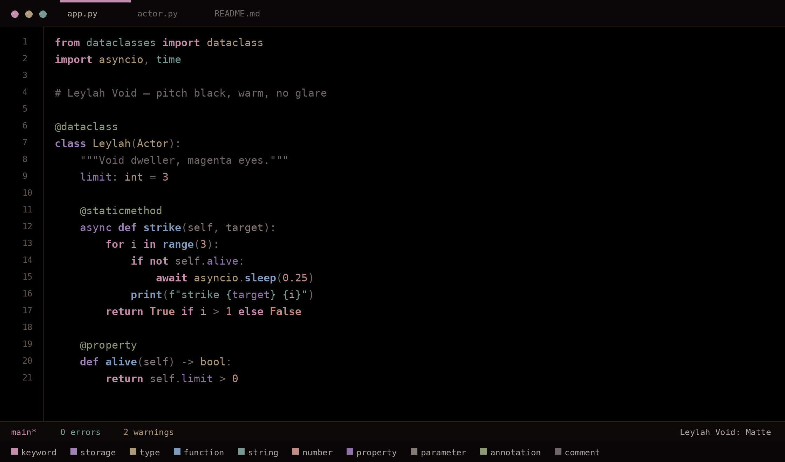

# Leylah Void

**One pitch-black theme, two finishes: Neon and Matte.**

Same warm hue family, same contrast system, same hierarchy. The only thing that changes is the finish — vivid or dusty.

| Neon | Matte |
| --- | --- |
|  |  |
| Max in-gamut chroma, signal tier at ~8.4:1 | Chroma held at 34% of max, compressed contrast |

<p>
  
  
  
</p>

---

## Why two

A car looks right either all matte or all gloss. Mixing finishes inside one theme is what looks wrong, so this repository ships both finishes as complete, internally consistent themes — not one theme with half its colors dulled.

- **Neon** — vivid, warm, high separation. For people who want the code to light up.
- **Matte** — dusty, warm, low glare. For long sessions and bright rooms.

Both keep the same hue assignments, so switching between them doesn't re-teach you the syntax colors.

## The design system

### Warm, not sharp

Every hue sits on the warm side of the wheel or is deliberately muted:

- rose `342°` · warm violet `305°` · periwinkle `255°` · teal `182°` · olive-green `126°` · gold `76°` · coral `28°`
- surfaces are warm charcoal (`#0C0908` neon, `#0D0A09` matte), never blue-black
- plain text is warm off-white `#E5D7D3` / `#AFA4A0`, never pure white
- peak contrast is capped at **8.4:1** instead of pushing toward 12:1, which is what usually causes glare on black
- no saturated cyan or electric blue: the coolest accents are a soft teal and a periwinkle

### Three contrast tiers

Colors are grouped by how much attention they deserve. Within a tier, every color is solved numerically to the same contrast ratio against `#000000`, so no token shouts by accident.

| Tier | Neon | Matte | What lives here |
| --- | --- | --- | --- |
| **Signal** | 8.38 – 8.44 : 1 | 6.30 – 7.78 : 1 | keywords, functions, types, strings, numbers, annotations |
| **Support** | 6.07 – 6.11 : 1 | 4.99 – 5.19 : 1 | properties, variables |
| **Noise** | 4.30 – 4.57 : 1 | 3.79 – 3.99 : 1 | operators, comments |

Matte uses a wider signal band on purpose: with chroma pulled down, **lightness** has to carry more of the separation.

### Attention hierarchy

Ordinary code stays quiet — variables sit in the support tier, punctuation and operators in noise. The moment a function name, keyword, type or string appears, it is the brightest thing on the line. Function names are bold in both variants.

### Colour theory

The signal hues form an **analogous arc** (rose → violet → periwinkle → teal → olive) with two warm anchors, **gold** and **coral**, opposite the cool end. Adjacent hues are at least **37°** apart, and the closest pair in each variant clears **ΔE 0.12** (neon) / **ΔE 0.05** (matte) in OKLab.

## The palettes

| Role | Neon | Matte |
| --- | --- | --- |
| Keywords — `if` `for` `return` | `#FE6FCF` | `#C58DAC` |
| Declarations — `const` `def` `class` | `#C18CF9` | `#9D82B6` |
| Functions & methods (bold) | `#65A6F9` | `#8199BB` |
| Strings, namespaces, regex | `#39B6A5` | `#779993` |
| Types, classes, interfaces | `#D89825` | `#AE987B` |
| Numbers, booleans, `None` | `#FA8072` | `#C18C86` |
| Annotations — `@Override` `@dataclass` | `#8BB044` | `#8B9A74` |
| Properties, fields | `#A970E3` | `#8F73A8` |
| Variables, parameters | `#9C857E` | `#857975` |
| Operators, punctuation | `#85716B` | `#736A67` |
| Comments | `#7C6E6A` | `#6E6765` |

UI surfaces stay between `#000000` and `#1A1210`, borders are warm `#33251F`, and the keyword color marks the cursor, active tab, focus ring and badges.

### Verification

```bash
python3 scripts/check-palette.py
```

Checks both variants: contrast bands, hue spacing (≥30°), perceptual distance, and that every declared hex exists in the theme file. Regenerate the palettes from scratch with:

```bash
python3 scripts/build-palettes.py   # rewrites both theme JSONs from themes/_base.json
```

**Known limitation:** equal-lightness palettes are weaker under colour-vision deficiency. Simulated deuteranopia collapses the closest pair to ΔE ≈ 0.017 (neon) / 0.009 (matte). Style carries part of the difference — annotations italic, functions bold — but strict CVD separation would require spreading lightness across ~1.5× contrast steps, which breaks the "everything equally bright" rule both variants follow.

---

## Install

The theme ships as a standard `.vsix`, so it works in VS Code, VSCodium and any VS Code–compatible editor. One package, two themes.

### VS Code

**GUI:** download [`dist/leylah-void-2.1.0.vsix`](dist/leylah-void-2.1.0.vsix), then open the Extensions view (`Ctrl+Shift+X`) → `...` menu → **Install from VSIX…** and pick the file.

**Terminal:**

```bash
code --install-extension dist/leylah-void-2.1.0.vsix
```

### VSCodium

**GUI:** same as above — Extensions view → `...` → **Install from VSIX…**

**Terminal:**

```bash
codium --install-extension dist/leylah-void-2.1.0.vsix
```

> On some distros the binary is called `vscodium` instead of `codium`.

### Cursor, Windsurf and other VS Code forks

```bash
cursor --install-extension dist/leylah-void-2.1.0.vsix
windsurf --install-extension dist/leylah-void-2.1.0.vsix
```

Or use the GUI: Extensions view → `...` → **Install from VSIX…**

### code-server / browser VS Code

```bash
code-server --install-extension dist/leylah-void-2.1.0.vsix
```

### Manual install (no CLI, no VSIX)

Copy the repository folder into your editor's extensions directory, so that `package.json` sits directly inside it:

| Editor | Linux | macOS | Windows |
| --- | --- | --- | --- |
| VS Code | `~/.vscode/extensions/leylah-void` | `~/.vscode/extensions/leylah-void` | `%USERPROFILE%\.vscode\extensions\leylah-void` |
| VSCodium | `~/.vscode-oss/extensions/leylah-void` | `~/.vscode-oss/extensions/leylah-void` | `%USERPROFILE%\.vscode-oss\extensions\leylah-void` |

Restart the editor afterwards.

### Build it yourself

No Node.js required — the build script only uses the Python standard library:

```bash
git clone https://github.com/Pushkar7270/leylah-void-vs-theme.git
cd leylah-void-vs-theme
python3 scripts/build-vsix.py
# -> dist/leylah-void-2.1.0.vsix
```

Regenerating the previews and icon needs [Pillow](https://python-pillow.org/):

```bash
python3 scripts/make-assets.py
```

---

## Activate

After installing, pick a finish:

1. Press `Ctrl+K Ctrl+T` (`Cmd+K Cmd+T` on macOS).
2. Choose **Leylah Void: Neon** or **Leylah Void: Matte**.

Or set it in `settings.json` (`Ctrl+Shift+P` → **Preferences: Open User Settings (JSON)**):

```json
{
  "workbench.colorTheme": "Leylah Void: Neon",
  "editor.semanticHighlighting.enabled": true,
  "editor.bracketPairColorization.enabled": true
}
```

Swap the label for `"Leylah Void: Matte"` to try the other finish.

## Uninstall

```bash
code --uninstall-extension pushkar7270.leylah-void      # VS Code
codium --uninstall-extension pushkar7270.leylah-void    # VSCodium
```

---

## Repository layout

```
.
├── package.json                        # extension manifest (two themes)
├── themes/
│   ├── _base.json                      # structural template (not shipped)
│   ├── leylah-void-neon-color-theme.json
│   └── leylah-void-matte-color-theme.json
├── assets/
│   ├── preview-neon.png                # README preview
│   ├── preview-matte.png               # README preview
│   └── icon.png                        # extension icon
├── scripts/
│   ├── build-palettes.py               # regenerates both theme JSONs
│   ├── check-palette.py                # contrast / hue / CVD verification
│   ├── build-vsix.py                   # builds dist/*.vsix, stdlib only
│   ├── install-local.sh                # build + install + drop stale copies
│   └── make-assets.py                  # regenerates previews + icon (Pillow)
├── dist/
│   └── leylah-void-2.1.0.vsix          # ready-to-install package
├── CHANGELOG.md
└── LICENSE
```

## Notes

- The palette was sampled from a reference illustration; neither the artwork nor any character asset is redistributed here.
- Both themes target `vs-dark`; there is no light variant.
- Tested on VSCodium 1.140 and VS Code 1.60+.

## License

[MIT](LICENSE)
