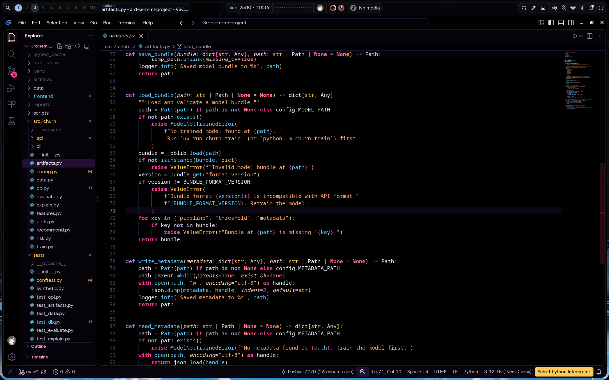

# Leylah Void

**A pitch-black VS Code theme with high-distinction syntax colors.**

Black background, magenta trim, violet starfield, gold armor, ice-blue accent — every token class gets its own hue so you can read a line in one glance.



<sub>Leylah Void in VSCodium — real project, real editor, pitch-black background.</sub>

<p>
  
  
  
</p>

---

## Why it looks like this

- **`#000000` editor background** — true black, not "very dark grey".
- **One hue per token class** — keywords, declarations, types, functions, strings, numbers, properties and parameters never share a color.
- **Contrast checked** — every syntax color is verified against `#000000`; the lowest is 4.72:1 (comments, intentionally recessive), everything else is 7:1 or higher.
- **Semantic highlighting on** — types, methods and properties stay correctly colored even where a grammar is ambiguous.
- **Bracket pair colorization** — six-color cycling, aligned with the palette.

## Palette

| Role | Color | Sample |
| --- | --- | --- |
| Control flow — `if` `for` `return` `await` `import` | hot magenta, bold | `#FF3D9A` |
| Declarations — `const` `class` `def` `async` `static` | violet | `#B98CFF` |
| Types, classes, interfaces, enums | gold | `#FFC857` |
| Functions & methods | ice blue | `#5CC8FF` |
| Strings | peach | `#FFA36B` |
| Numbers, booleans, `null` / `None` | coral | `#FF6B81` |
| Properties, fields, attributes | lilac | `#C9B8F5` |
| Parameters | warm rose, italic | `#F5C6B0` |
| Annotations, decorators, attributes — `@Override` `@dataclass` | emerald, italic | `#7CE38B` |
| Namespaces, modules, regex | teal | `#7BE0CE` |
| Operators | muted lavender | `#A79FCB` |
| Comments | grey-violet, italic | `#7A7396` |

UI surfaces stay between `#000000` and `#120C1E`, borders are deep indigo `#1C1530`, and magenta `#FF3D9A` marks the cursor, active tab, focus ring and badges.

---

## Install

The theme ships as a standard `.vsix`, so it works in VS Code, VSCodium and any VS Code–compatible editor.

### VS Code

**GUI:** download [`dist/leylah-void-1.1.1.vsix`](dist/leylah-void-1.1.1.vsix), then open the Extensions view (`Ctrl+Shift+X`) → `...` menu → **Install from VSIX…** and pick the file.

**Terminal:**

```bash
code --install-extension dist/leylah-void-1.1.1.vsix
```

### VSCodium

**GUI:** same as above — Extensions view → `...` → **Install from VSIX…**

**Terminal:**

```bash
codium --install-extension dist/leylah-void-1.1.1.vsix
```

> On some distros the binary is called `vscodium` instead of `codium`.

### Cursor, Windsurf and other VS Code forks

Each fork has its own CLI that accepts the same file:

```bash
cursor --install-extension dist/leylah-void-1.1.1.vsix
windsurf --install-extension dist/leylah-void-1.1.1.vsix
```

Or use the GUI: Extensions view → `...` → **Install from VSIX…**

### code-server / browser VS Code

```bash
code-server --install-extension dist/leylah-void-1.1.1.vsix
```

### Manual install (no CLI, no VSIX)

Copy the repository folder into your editor's extensions directory, so that `package.json` sits directly inside it:

| Editor | Linux | macOS | Windows |
| --- | --- | --- | --- |
| VS Code | `~/.vscode/extensions/leylah-void` | `~/.vscode/extensions/leylah-void` | `%USERPROFILE%\.vscode\extensions\leylah-void` |
| VSCodium | `~/.vscode-oss/extensions/leylah-void` | `~/.vscode-oss/extensions/leylah-void` | `%USERPROFILE%\.vscode-oss\extensions\leylah-void` |

Restart the editor afterwards.

### Build it yourself

No Node.js required — the build script only uses the Python standard library:

```bash
git clone https://github.com/Pushkar7270/leylah-void-vs-theme.git
cd leylah-void-vs-theme
python3 scripts/build-vsix.py
# -> dist/leylah-void-1.1.1.vsix
```

Regenerating the preview image and icon needs [Pillow](https://python-pillow.org/):

```bash
python3 scripts/make-assets.py
```

---

## Activate the theme

After installing, the editor may keep your current theme. Select it once:

1. Press `Ctrl+K Ctrl+T` (`Cmd+K Cmd+T` on macOS).
2. Choose **Leylah Void**.

To make it the default, add this to your `settings.json` (`Ctrl+Shift+P` → **Preferences: Open User Settings (JSON)**):

```json
{
  "workbench.colorTheme": "Leylah Void",
  "editor.semanticHighlighting.enabled": true,
  "editor.bracketPairColorization.enabled": true
}
```

The last two lines are optional but recommended — they enable the semantic colors and bracket colors the theme is designed around.

## Uninstall

```bash
code --uninstall-extension pushkar7270.leylah-void      # VS Code
codium --uninstall-extension pushkar7270.leylah-void    # VSCodium
```

Or right-click the extension in the Extensions view → **Uninstall**.

---

## Repository layout

```
.
├── package.json                        # extension manifest
├── themes/
│   └── leylah-void-color-theme.json    # the theme: 535 UI colors + token rules
├── assets/
│   ├── screenshot.png                  # real VSCodium screenshot (README hero)
│   ├── preview.png                     # generated palette preview
│   └── icon.png                        # extension icon (generated)
├── scripts/
│   ├── build-vsix.py                   # builds dist/*.vsix, stdlib only
│   └── make-assets.py                  # regenerates preview + icon (Pillow)
├── dist/
│   └── leylah-void-1.1.1.vsix          # ready-to-install package
├── CHANGELOG.md
└── LICENSE
```

## Notes

- The palette was sampled from a reference illustration; neither the artwork nor any character asset is redistributed here.
- The theme targets `vs-dark`; there is no light variant.
- Tested on VSCodium 1.140 and VS Code 1.60+.

## License

[MIT](LICENSE)
